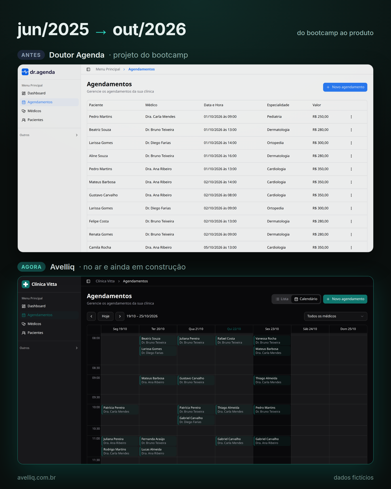

# 🩺 Avelliq


Sistema de agendamento para clínicas médicas: cadastro de médicos com dias e horários de atendimento, pacientes, consultas com horários livres calculados automaticamente, e um dashboard de faturamento. Toda conta começa no plano Free, e os planos pagos são cobrados via Stripe.

🔗 **Aplicação online:** [www.avelliq.com.br](https://www.avelliq.com.br)

> 💳 **Os planos pagos usam o modo de testes do Stripe.** Use o cartão `4242 4242 4242 4242`, com qualquer data de validade futura, CVC e CEP. **Não use dados reais de cartão.**

> 🧪 **Vai testar o sistema?** Comece pelo [Guia de testes (QA)](#-guia-de-testes-qa): ele explica, sem precisar ler código, o que testar e o resultado esperado.

### Do bootcamp ao Avelliq

O projeto começou em junho de 2025 como o Doutor Agenda, no bootcamp "SaaS de Agendamentos para Clínicas" da Full Stack Club. Ficou parado por mais de um ano e, em outubro de 2026, foi retomado e virou o Avelliq. Ainda está em construção.



---

## ✨ Funcionalidades

- **Autenticação** com e-mail e senha ou conta Google ([Better Auth](https://www.better-auth.com)), com recuperação de senha por e-mail. Em Minha conta dá para alterar a senha, e quem entrou pelo Google pode criar uma para também entrar com e-mail e senha.
- **E-mails com a cara do Avelliq:** confirmação de e-mail, redefinição de senha, respostas do Atendimento e mensagens do formulário de ajuda saem com o mesmo layout (logo, cartão branco com a faixa azul, botão e rodapé), feito com tabelas e estilos inline para funcionar no Gmail e no Outlook. Todo e-mail tem também a versão em texto puro. O layout fica em [`src/lib/email.ts`](src/lib/email.ts).
- **Clínica:** cada usuário trabalha dentro da sua clínica, e os dados de uma clínica não são visíveis para outra.
- **Médicos:** especialidade, valor da consulta, dias da semana e horário de atendimento.
- **Pacientes:** cadastro e listagem. Além dos dados básicos, a clínica pode registrar data de nascimento, CPF, endereço (preenchido pelo CEP), convênio, contato de emergência e observações administrativas.
- **Agendamentos:** só oferece horários dentro do expediente do médico e que ainda não estejam ocupados.
- **Dashboard:** faturamento, número de consultas, médicos e especialidades mais procurados, e os agendamentos do dia.
- **Marca da clínica (white label):** em Configurações da clínica, cada clínica envia o próprio logo (PNG, JPG ou WebP, reduzido para 128 px e guardado no banco) e escolhe a cor principal. O menu passa a mostrar a marca da clínica e os botões usam a cor dela, com o texto em branco ou preto conforme o contraste.
- **Tema claro e escuro:** segue o tema do sistema ou a escolha feita no menu do rodapé (Tema).
- **Ajuda no app:** um botão "Ajuda" no canto da tela responde na hora às dúvidas mais comuns (planos, cadastros, agendamentos, conta), por palavras-chave, sem IA. Quando a resposta não resolve, "Falar com a equipe" abre um formulário que envia a mensagem por e-mail, com o contexto da conta e "responder para" o e-mail de quem escreveu. As respostas ficam em [`src/lib/support/answers.ts`](src/lib/support/answers.ts).
- **Atendimento (equipe do Avelliq):** em `/atendimento`, a caixa de entrada do domínio: e-mails enviados para o `sac@` e mensagens do formulário de ajuda.
  - **Quem vê:** só a equipe do Avelliq. As contas principais veem tudo o que chega ao domínio. Admin e Suporte veem e respondem só o que foi enviado ao `SUPPORT_EMAIL` ou ao `SUPPORT_INBOX`. QA vê, mas não responde.
  - **Responder:** a resposta sai do `SUPPORT_EMAIL`, na mesma conversa do e-mail original, e cita só o texto da pessoa. Nas mensagens do formulário, os dados internos da conta não voltam para o cliente. E-mails vindos de endereços do próprio Avelliq não podem ser respondidos.
  - **Segurança:** e-mails em HTML aparecem isolados, sem scripts, sem imagens externas e com os links desativados, para que o remetente não saiba que o e-mail foi aberto.
  - **Registro:** cada resposta fica no registro de auditoria com quem a enviou. Uma mensagem só aparece como "Formulário" quando vem do `EMAIL_FROM`.
  - **Por dentro:** os e-mails são lidos pela API de recebimento do Resend, e a resposta mantém a cadeia de `References` do original.
- **Contas e cargos da equipe:** em `/contas`, a lista de todas as contas do Avelliq com busca por nome ou e-mail, plano, clínicas e forma de entrar. Ali se escolhe o cargo de cada pessoa da equipe; só contas com e-mail confirmado entram na equipe, e cada mudança fica no registro de auditoria com quem a fez. Principal, Admin e Suporte não precisam de plano: usam o sistema sem limites e sem o fim do período gratuito. A tela Assinatura continua mostrando os planos, e quem quiser pode assinar.
  - **Principal** (`SUPPORT_ADMIN_EMAILS`): vê tudo e escolhe quem é Admin, Suporte e QA. Não aparece como cargo no banco e não pode ser tirada pela tela.
  - **Admin:** vê o Atendimento e a tela Contas, e escolhe quem é Suporte e QA. Não pode tornar ninguém Admin nem mudar outro Admin.
  - **Suporte:** vê e responde o Atendimento.
  - **QA:** testa o sistema. Vê todas as telas, inclusive o Atendimento e a tela Contas, mas não responde clientes nem muda cargos. Segue as regras de plano como um cliente e, em Assinatura, escolhe qual plano simular (Free, Essencial ou Profissional), sem pagar e sem mexer no Stripe.
- **Planos** Free, Essencial e Profissional, com Stripe Checkout para assinar e o portal do cliente para trocar de plano ou cancelar.
- **LGPD:** Política de Privacidade e Termos de Uso com aceite registrado, exportação dos dados, exclusão da conta, registro de auditoria e limpeza automática de dados antigos. Detalhes e pendências em [`docs/lgpd`](docs/lgpd/README.md).
- **Sessão:** quem fica 12 horas sem usar o sistema precisa entrar de novo. Usar o sistema adia esse prazo, renovado no máximo uma vez por hora.

## 💼 Planos

| | Free | Essencial | Profissional |
|---|---|---|---|
| Cobrança | Grátis por 3 meses | Mensal ou anual | Mensal ou anual |
| Clínicas | 1 | 2 | Ilimitadas |
| Médicos (por clínica) | 1 | 5 | Ilimitados |
| Pacientes (por clínica) | 20 | 100 | Ilimitados |
| Agendamentos por mês (por clínica) | 40 | 200 | Ilimitados |

- **Limites:** os limites são verificados no servidor, ao cadastrar médicos, pacientes e agendamentos. Ficam em [`src/lib/plans.ts`](src/lib/plans.ts).
- **Visibilidade:** a página de assinatura mostra o uso de cada limite. Os botões de cadastro mostram o uso e, no limite, abrem um aviso explicando o motivo, com o caminho para o plano maior. Um aviso no topo das páginas informa cancelamento agendado, pagamento pendente e o fim do período gratuito.
- **Preços:** o valor exibido de cada plano pago vem do próprio Stripe, então é sempre o mesmo cobrado no checkout.
- **Plano anual:** opcional. Com os preços anuais configurados (`STRIPE_*_ANNUAL_PRICE_ID`), a página de assinatura ganha a escolha Mensal/Anual e mostra a economia em relação a 12 meses do mensal. Sem eles, só o mensal aparece.
- **No banco:** um usuário sem assinatura tem `plan` vazio e é tratado como Free.
- **Várias clínicas:** o seletor no rodapé do menu troca a clínica aberta; cada clínica tem seus próprios médicos, pacientes e agendamentos. Em **Minhas clínicas**, quem tem mais clínicas do que o plano permite (depois de um downgrade) escolhe quais continuam ativas; as outras ficam só leitura, sem perder dados. A primeira escolha é livre e, depois, vale uma alteração a cada 30 dias; para mais, o usuário fala com o suporte.
- **Fim do Free:** 3 meses depois da criação da clínica, a conta fica só leitura. Dá para ver os dados, mas cadastrar, editar e excluir exige um plano pago. Clínicas criadas antes dessa regra contam os 3 meses a partir de 15/10/2026. O prazo é controlado pelo app, não pelo Stripe.

## 🧪 Guia de testes (QA)

Esta seção é para quem testa o Avelliq pelo navegador, sem precisar ler código.

### Antes de começar

1. **Crie uma conta** em [www.avelliq.com.br](https://www.avelliq.com.br) e confirme o e-mail pelo link recebido.
2. **Peça o cargo de QA** a um Admin ou a uma conta principal. Eles dão o cargo na tela **Contas**. Só contas com e-mail confirmado podem receber cargo.
3. **Recarregue a página.** O cargo pode levar até 5 minutos para aparecer.

**O que QA pode fazer:**

- Ver todas as telas, inclusive **Atendimento** e **Contas**. QA não responde clientes nem muda cargos.
- Testar os planos como um cliente: em **Assinatura**, o cartão **Simular plano (conta QA)** escolhe Free, Essencial ou Profissional. O sistema passa a aplicar os limites, bloqueios e avisos desse plano. Nada é cobrado. Para voltar, escolha **Meu plano de verdade**.

**Regras para os testes:**

- **Dados fictícios:** use só nomes, e-mails, CPFs e telefones inventados. Nunca cadastre dados reais de pacientes.
- **Pagamento:** se testar o checkout do Stripe, use só o cartão de teste `4242 4242 4242 4242`.
- **Bugs:** ao reportar um bug, descreva o passo a passo, o resultado esperado e o resultado obtido, e anexe um print. Não coloque senhas nem dados pessoais no relato.

### Roteiro de testes

| Área | Como testar | Resultado esperado |
|---|---|---|
| Cadastro e e-mail | Crie uma conta com e-mail e senha | Chega um e-mail "Confirme seu email" com o botão **Confirmar meu email**. A conta só entra depois de confirmar |
| Esqueci minha senha | Em **Entrar**, use "Esqueci minha senha" | Chega um e-mail com o botão **Criar uma nova senha**. O link vale por 1 hora. Depois de trocar a senha, os outros aparelhos saem da conta |
| Login com Google | Entre com uma conta Google | Entra sem pedir senha. Em **Minha conta** dá para criar uma senha |
| Sessão | Fique 12 horas sem usar o sistema | Pede para entrar de novo |
| Médicos | Cadastre um médico com dias e horário de atendimento | Ele aparece na lista e nos agendamentos |
| Pacientes | Cadastre um paciente e preencha o CEP | O endereço é preenchido sozinho. Dois pacientes da mesma clínica não podem ter o mesmo CPF |
| Agendamentos | Crie uma consulta | Só aparecem horários dentro do expediente do médico e ainda livres. O mesmo horário do mesmo médico não pode ser marcado duas vezes |
| Calendário | Em **Agendamentos**, troque para **Calendário** | A semana mostra as consultas nos horários certos (horário de Brasília) |
| Dashboard | Abra o **Dashboard** | Faturamento, número de consultas e agendamentos do dia batem com o que foi cadastrado |
| Limites do plano | Simule o Free e cadastre mais de 1 médico, 20 pacientes ou 40 consultas no mês | No limite, o botão abre um aviso explicando o motivo e o caminho para o plano maior. Veja a tabela de [Planos](#-planos) |
| Várias clínicas | Simule o Essencial e crie 2 clínicas | O seletor no rodapé do menu troca de clínica, e os dados de uma clínica não aparecem na outra |
| Downgrade | Simule o Profissional, crie 3 clínicas e depois simule o Essencial | **Minhas clínicas** pede para escolher quais 2 continuam ativas. As outras ficam só leitura, sem perder dados |
| Marca da clínica | Em **Configurações da clínica**, envie um logo e escolha uma cor | O menu mostra o logo, e os botões usam a cor escolhida com o texto legível |
| Tema | No menu do rodapé, troque o tema | Claro e escuro funcionam em todas as telas |
| Ajuda | Clique em **Ajuda** e digite uma dúvida | Aparece uma resposta pronta. "Falar com a equipe" envia a mensagem, que chega no **Atendimento** |
| LGPD | Em **Minha conta**, use **Baixar meus dados** e **Excluir conta** | O download traz os dados da conta. A exclusão apaga a conta e encerra a sessão |
| Celular | Repita os fluxos principais com a tela do celular | Nada fica cortado e não aparece rolagem para o lado |

**Fim do período gratuito:** o Free vira só leitura 3 meses depois da criação da clínica, e esse prazo não dá para adiantar pela tela. Para testar esse caso, peça a quem desenvolve para ajustar a data da clínica num banco de testes.

## 🚀 Tecnologias

| Área | Ferramentas |
|---|---|
| Framework | Next.js 15 (App Router, Server Actions), React 19, TypeScript |
| Banco de dados | PostgreSQL, Drizzle ORM |
| Autenticação | Better Auth |
| Pagamentos | Stripe |
| Interface | Tailwind CSS, shadcn/ui (Radix UI), React Hook Form, Zod |
| Dados no cliente | next-safe-action, TanStack Query, nuqs |
| Datas | dayjs, date-fns |
| Testes | Vitest |
| Deploy | Vercel |

---

## 🧑‍💻 Rodando localmente

**Pré-requisitos:** Node.js 20+ e um banco PostgreSQL.

1. Instale as dependências:

   ```bash
   npm install
   ```

2. Copie o `.env.example` para `.env` e preencha as variáveis abaixo:

   ```bash
   cp .env.example .env
   ```

   | Variável | Para quê |
   |---|---|
   | `DATABASE_URL` | Conexão com o PostgreSQL |
   | `BETTER_AUTH_SECRET` | Chave usada para assinar as sessões (gere uma string aleatória longa) |
   | `BETTER_AUTH_URL` | URL base da aplicação, por exemplo `http://localhost:3000` |
   | `NEXT_PUBLIC_APP_URL` | URL pública da aplicação, usada nos redirecionamentos do Stripe e nos links dos e-mails (o logo dos e-mails vem sempre de www.avelliq.com.br) |
   | `GOOGLE_CLIENT_ID`, `GOOGLE_CLIENT_SECRET` | Login com Google |
   | `STRIPE_SECRET_KEY` | Chave secreta do Stripe (modo de testes). O checkout abre na página hospedada pelo Stripe, sem Stripe.js no app, então a chave pública não é usada |
   | `STRIPE_ESSENTIAL_PLAN_PRICE_ID` | ID do preço mensal do plano Essencial no Stripe |
   | `STRIPE_PROFESSIONAL_PLAN_PRICE_ID` | ID do preço mensal do plano Profissional no Stripe |
   | `STRIPE_ESSENTIAL_ANNUAL_PRICE_ID`, `STRIPE_PROFESSIONAL_ANNUAL_PRICE_ID` | IDs dos preços anuais (opcionais). Com eles, a página de assinatura mostra a opção Mensal/Anual com a economia calculada. Libere também os preços anuais em **Stripe → Customer portal → Products**, senão quem assina não consegue trocar de plano pelo portal |
   | `STRIPE_WEBHOOK_SECRET` | Segredo do webhook (veja a seção do Stripe abaixo) |
   | `NEXT_PUBLIC_STRIPE_CUSTOMER_PORTAL_URL` | Link do portal do cliente do Stripe. No Stripe, configure o link de retorno do portal para `/assinatura` |
   | `SUPPORT_EMAIL` | E-mail de suporte e canal de privacidade, mostrado na Política de Privacidade, nos Termos e a quem precisa alterar as clínicas ativas antes dos 30 dias. Use um e-mail do domínio, não um pessoal |
   | `SUPPORT_INBOX` | Caixa que recebe as mensagens do "Falar com a equipe" (opcional; sem ela, vão para `SUPPORT_EMAIL`, o recomendado). Nunca aparece nas páginas, mas um e-mail pessoal aqui tem dois efeitos: quem responder de lá mostra esse endereço ao cliente, e as mensagens não chegam à caixa do domínio recebida pelo Resend (a tela de Atendimento não as vê). Exige `RESEND_API_KEY` e `EMAIL_FROM` |
   | `RESEND_RECEIVING_API_KEY` | Chave do Resend com permissão **Full access**, usada só pela tela de Atendimento para ler os e-mails recebidos (a chave de envio, `RESEND_API_KEY`, pode continuar só com envio). Opcional |
   | `SUPPORT_ADMIN_EMAILS` | E-mails (separados por vírgula) das contas principais do Avelliq: veem o Atendimento e a tela Contas, onde escolhem quem é Admin, Suporte e QA. A conta precisa ter o e-mail confirmado. Opcional |
   | `LEGAL_CNPJ` | CNPJ mostrado na Política de Privacidade e nos Termos (opcional). Fica fora do código porque o repositório é público |
   | `RESEND_API_KEY`, `EMAIL_FROM` | Envio de emails pelo [Resend](https://resend.com). Com as duas definidas, a conta só é liberada depois de confirmar o email e o "Esqueci minha senha" fica disponível (opcional) |
   | `CRON_SECRET` | Segredo da limpeza diária (Vercel Cron) de sessões expiradas e registros de auditoria com mais de 5 anos. Sem ele, a limpeza não roda |

3. Crie as tabelas no banco a partir do schema:

   ```bash
   npx drizzle-kit push
   ```

   Use `push`, não `migrate`: as primeiras migrações da pasta `drizzle/` são da versão original do projeto e não rodam em sequência num banco vazio.

4. Inicie o servidor de desenvolvimento e abra [http://localhost:3000](http://localhost:3000):

   ```bash
   npm run dev
   ```

### Scripts

| Comando | O que faz |
|---|---|
| `npm run dev` | Servidor de desenvolvimento |
| `npm run build` | Build de produção. Na Vercel (produção), antes confere se o banco tem todas as colunas e índices do schema |
| `npm start` | Sobe o build de produção |
| `npm run lint` | ESLint |
| `npm test` | Testes com Vitest |
| `npm run test:integration` | Testes contra um PostgreSQL real (defina `INTEGRATION_DATABASE_URL` com um banco de teste) |
| `npx drizzle-kit studio` | Interface visual do banco |

### Stripe em ambiente local

Para receber os eventos de pagamento na sua máquina, use a [Stripe CLI](https://docs.stripe.com/stripe-cli):

```bash
stripe login
stripe listen --forward-to localhost:3000/api/stripe/webhook
```

O comando `stripe listen` mostra um segredo `whsec_...`. Coloque esse valor em `STRIPE_WEBHOOK_SECRET` no `.env`.

---

## 🧭 Rotas

As páginas usam endereços em português: `/painel`, `/agendamentos`, `/medicos`, `/pacientes`, `/assinatura`, `/clinicas`, `/configuracoes-da-clinica`, `/nova-clinica`, `/minha-conta`, `/atendimento`, `/contas`, `/entrar`, `/esqueci-senha` e `/redefinir-senha`. Os endereços antigos em inglês redirecionam permanentemente para os novos (veja `next.config.ts`). As rotas de API continuam em `/api/...`.

---

## 🗄️ Banco de produção

O banco de produção foi criado com `drizzle-kit push` e não tem o histórico do `drizzle-kit migrate`. Cada mudança de schema gera um arquivo novo em `drizzle/` (`npx drizzle-kit generate --name <nome>`), que é aplicado à mão, **antes do merge** do código que depende dele:

```bash
psql "$DATABASE_URL" -P pager=off -f drizzle/000X_nome.sql
```

Se a migração for esquecida, o deploy não chega a ir ao ar: no build de produção da Vercel, [`scripts/check-db-schema.mjs`](scripts/check-db-schema.mjs) compara as colunas e os índices do schema com os do banco e falha o build listando o que falta, e a versão anterior continua no ar. Para rodar a mesma verificação localmente: `CHECK_DB_SCHEMA=1 npm run build`.

Não cole a `DATABASE_URL` em chats, issues ou commits.

---

## 🕒 Fuso horário

A clínica opera no fuso `America/Sao_Paulo`, mas o servidor pode estar em qualquer fuso (na Vercel, é UTC). Por isso:

- O horário de atendimento dos médicos e a data das consultas são **gravados em UTC**.
- Tudo o que é exibido ou escolhido na interface está **no horário da clínica**.
- As conversões ficam todas em [`src/helpers/time.ts`](src/helpers/time.ts). Use essas funções em vez de converter datas diretamente com `dayjs()` ou `new Date()`, que dependem do fuso de quem executa o código.

---

## 📋 Próximos passos

- [ ] Autenticação em dois fatores
- [ ] Campo `status` nos agendamentos
- [ ] Manter o histórico de agendamentos ao excluir um médico (hoje são apagados junto)
- [ ] Content Security Policy para scripts, com nonce por requisição
